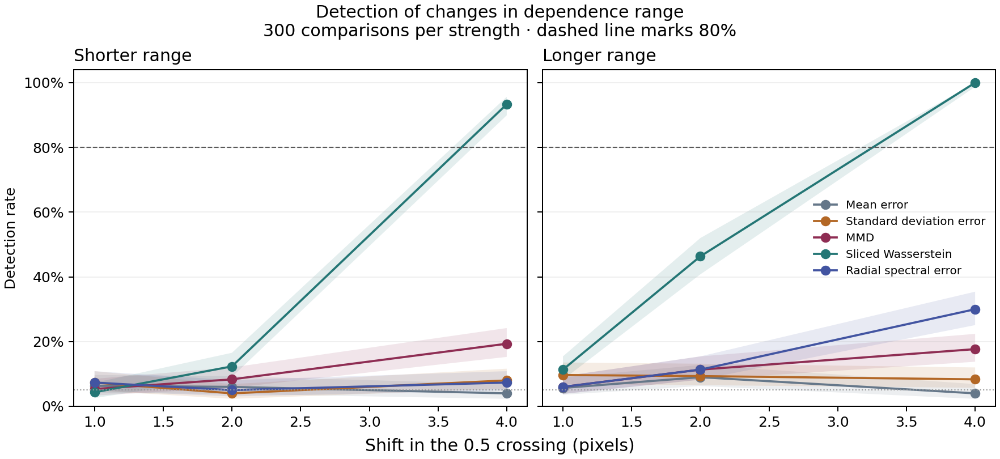
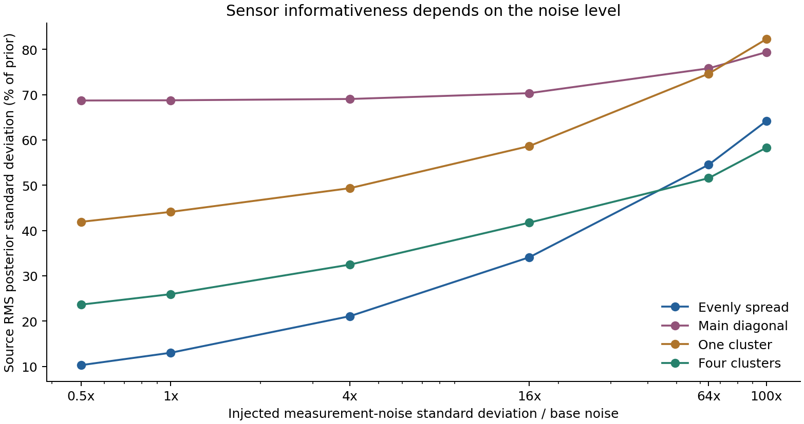
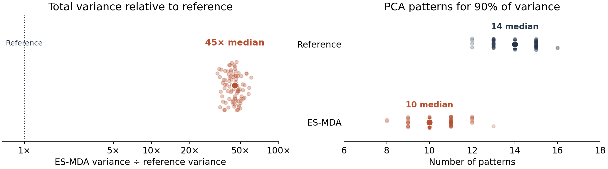
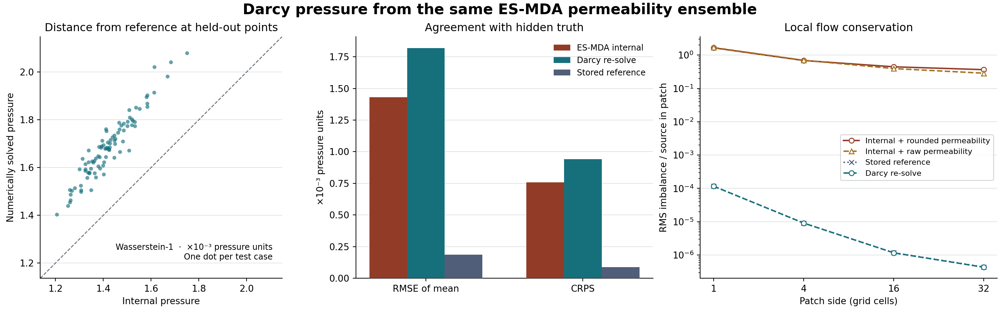
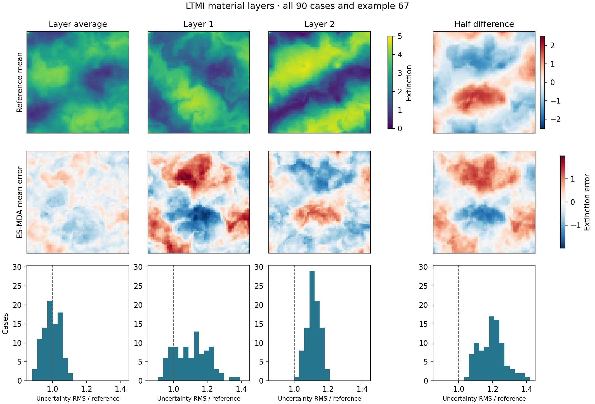

# PosteriorBench Experiments

**Five experiments on spatial dependence, posterior uncertainty, and physical consistency.**

Rishit Dutta · IIT Kanpur

An inverse problem asks which hidden fields could have produced a set of observations. Recovering a plausible average field is only part of the problem: a posterior also has to describe what remains uncertain, how locations vary together, and whether inferred quantities obey the forward model.

This repository investigates those questions using [PosteriorBench](https://github.com/neuraloperator/PosteriorBench). It contains my experimental analyses and ES-MDA reruns, with saved numerical results, figures, and reproduction code. **PosteriorBench, its datasets, evaluation metrics, and released ES-MDA implementation are the work of the original authors.**

[Experiments](#the-five-experiments) · [Reproduce](docs/reproduction.md) · [Evidence index](docs/evidence.md) · [Scope and limitations](docs/scope.md) · [Provenance](provenance.json)

## The five experiments

| | Question | Main observation |
|---|---|---|
| **1** | [Can the metrics see spatial dependence?](docs/01_spatial_dependence.md) | At a 4-pixel correlation-range shift, SWD detected 93% of shorter-range and 100% of longer-range changes. Directional and long-range anticorrelation changes were much less detectable in the tested controls. |
| **2** | [How does sensor placement affect uncertainty?](docs/02_sensor_placement.md) | Even spacing leaves the least exact source uncertainty through 16× injected noise; four clusters leave the least at 64× and 100×. The ES-MDA map comparison uses **4× assumed noise and 512 members**. |
| **3** | [Where does ES-MDA put posterior variance?](docs/03_posterior_geometry.md) | Across 90 Poisson cases, ES-MDA has a median paired variance ratio of **45×**, while **10** PCA modes explain 90% of its variance versus **14** for the reference. |
| **4** | [Does internal pressure satisfy Darcy's equation?](docs/04_darcy_consistency.md) | Re-solving the inferred permeability restores local conservation, yet worsens held-out pressure RMSE and reference distance in **all 90 cases**. |
| **5** | [What does ES-MDA recover on LTMI?](docs/05_ltmi_recovery.md) | Internal light predictions improve beyond the observed resolution. But the scored layer average hides **79.6%** of the combined squared mean error in the two material layers. |

The first study tests metric sensitivity using controlled fields. The second studies sensor informativeness under a fixed Gaussian prior. The last three analyse ES-MDA on the released test cases. Their conclusions have different scopes; the linked experiment pages spell these out.

### 1 · Changing dependence while keeping pointwise distributions fixed



Each ensemble has 100 fields. Thresholds are calibrated using independent ensembles from the same generator. A low score can coexist with a change that is difficult for that metric to detect. [Setup, controls, and interpretation →](docs/01_spatial_dependence.md)

### 2 · The most informative layout depends on noise



The curves measure remaining source uncertainty under exact Gaussian conditioning. **Injected measurement noise** on this axis is different from the **assumed ES-MDA noise multiplier** used in the separate 4× map comparison. [See the maps and definitions →](docs/02_sensor_placement.md)

### 3 · More variance can occupy fewer patterns



Variance magnitude and variance geometry answer different questions. Here ES-MDA spreads much more, but that spread is concentrated in fewer leading linear patterns. [Means, variances, PCA maps, and caveats →](docs/03_posterior_geometry.md)

### 4 · Physical consistency and predictive fit can move in opposite directions



The numerical solve uses the same saved permeability map as the internal pressure it is paired with. It repairs a physical inconsistency while exposing a larger pressure error. [Paired design and numerical checks →](docs/04_darcy_consistency.md)

### 5 · An average can conceal opposite layer errors



An overestimate in one layer can cancel an underestimate in the other. The scored average can therefore look substantially better than either underlying layer. [Light-detail analysis and error decomposition →](docs/05_ltmi_recovery.md)

## Inspect the results without rerunning inference

The small tables, settings, and figures are committed under [`results/`](results) and [`figures/`](figures). No GPU or data download is needed to read them. To verify the reported headline numbers and regenerate compact summary plots:

```bash
python -m pip install -r requirements-figures.txt
python tools/validate_results.py
python tools/plot_results.py --output runs/summary_figures
```

For data download, full experiment commands, and the distinction between archived results and fresh reruns, see [reproduction instructions](docs/reproduction.md). Large training datasets and raw HDF5 ensembles are excluded from Git.

## Code and provenance

| Location | Purpose |
|---|---|
| [`experiments/`](experiments) | Experiment scripts, grouped by research question |
| [`results/`](results) | Saved per-case tables, summaries, configurations, and evaluator outputs |
| [`figures/`](figures) | Selected presentation and analysis figures |
| [`docs/`](docs) | Motivation, experimental design, interpretation, and limitations |
| [`vendor/PosteriorBench/`](vendor/PosteriorBench) | Focused, unmodified upstream source snapshot and its MIT license |
| [`provenance/`](provenance) | Original and packaged file hashes, plus packaging notes |

The benchmark snapshot is pinned to [`ab416f5`](https://github.com/neuraloperator/PosteriorBench/tree/ab416f5b322717f5668de01889ae0141dbc00af6); data are pinned to revision [`f457193`](https://huggingface.co/datasets/jcy20/PosteriorBench/tree/f45719309a0ea6500b86e6e9973c18b3ffff8650). See the [PosteriorBench paper](https://arxiv.org/abs/2609.20794) for the original benchmark and methods. The Poisson geometry rerun uses one verified 3,572-field training shard; Darcy and LTMI use their complete released prior pools.

If you use these analyses, please credit this repository and cite the original PosteriorBench work. Upstream license terms are retained in [`vendor/PosteriorBench/LICENSE`](vendor/PosteriorBench/LICENSE); this release does not assign a new license to the original experiment additions.
