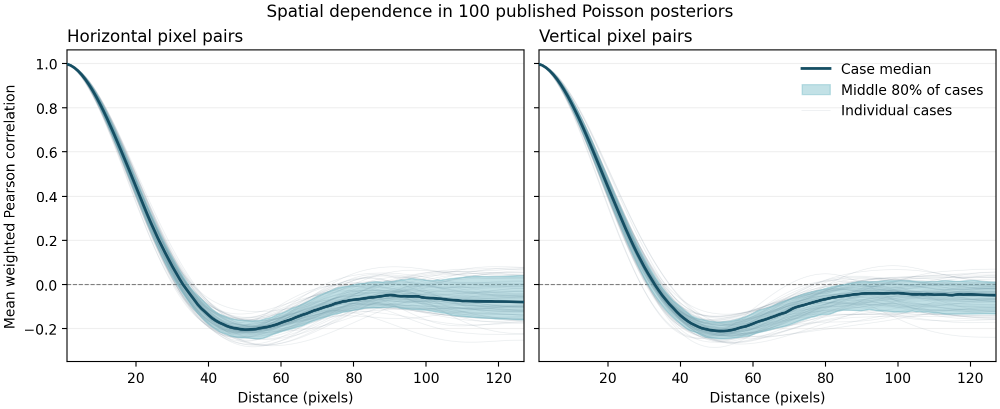
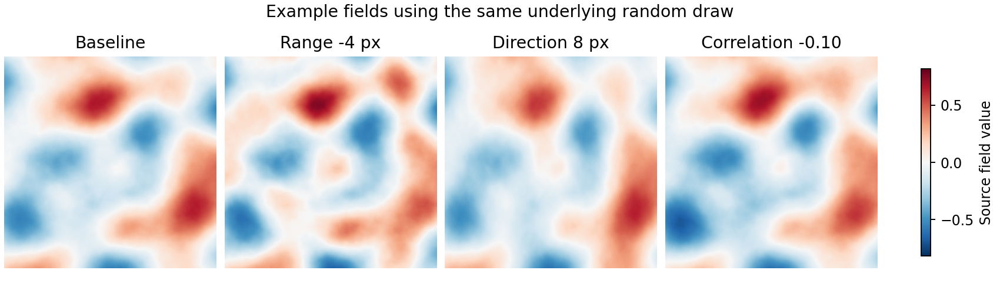
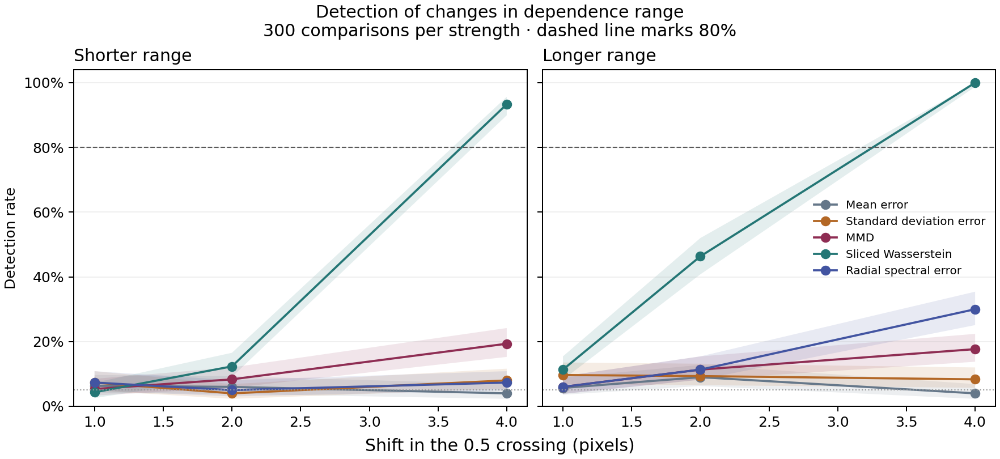
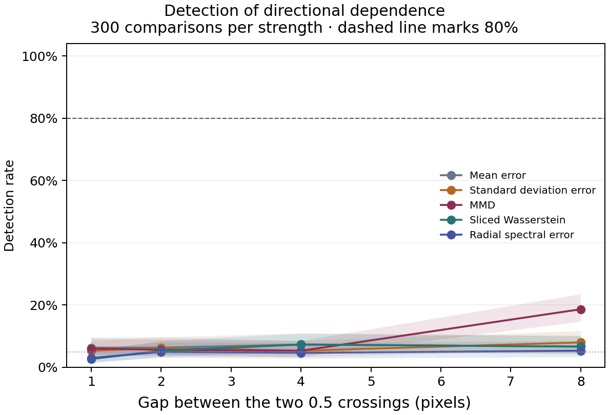
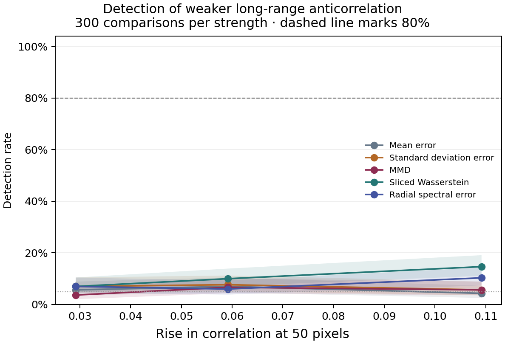

# 1 · Can PosteriorBench see spatial dependence?

[← Overview](../README.md) · [Evidence](evidence.md) · [Reproduce](reproduction.md#1-spatial-dependence)

## Motivation

Two field distributions can have the same marginal distribution at every pixel while placing their mass on different spatial patterns. The uncertainty at individual locations is then unchanged, but the relationships between locations differ. How sensitive are PosteriorBench's reported metrics to that difference?

Poisson source recovery provides a useful starting point. The supplied weighted reference ensembles contain smooth spatial dependence: pixel correlation crosses 0.5 at roughly 19 pixels and becomes negative at longer separations. We measure both pixel correlations and correlations between sliding-window averages before designing perturbations.

## Controlled experiment

Fit a stationary Gaussian random-field baseline to the reference correlation curves. Change one of three properties while preserving the pointwise Gaussian mean and variance:

1. **Range:** move the 0.5 correlation crossing by −4, −2, −1, +1, +2, or +4 pixels.
2. **Direction:** change horizontal versus vertical correlation range.
3. **Long-range anticorrelation:** weaken correlation around a separation of 50 pixels while keeping short-range changes small.

The controls use 128×128 fields and 100 equally weighted samples per ensemble. For each metric, calibrate a cutoff at the 95th percentile of 1,000 same-generator comparisons. Run 300 independent comparisons for each changed generator. This produces 4,900 comparison records across the null and 13 alternatives. A metric detects a change when its score exceeds its own calibrated cutoff.

This is a sensitivity study of the chosen controls. The fitted Gaussian fields are not claimed to reproduce the entire non-Gaussian reference posterior.

## Results

| Controlled change | Observed detection |
|---|---:|
| Range shorter by 4 pixels, SWD | 280/300 = 93.3% |
| Range longer by 4 pixels, SWD | 300/300 = 100% |
| Directional changes, best metric/strength tested | 19% |
| Long-range anticorrelation changes, best metric/strength tested | 15% |

SWD crosses the chosen 80% detection criterion between the tested 2- and 4-pixel shifts in each range direction. This brackets a threshold on the tested grid; it does not locate an exact continuous threshold.

## Intuitive interpretation

Matching pixelwise means and variances leaves many possible joint distributions. A metric can respond strongly to one spatial change and weakly to another. Here smooth-field projections expose range shifts much more readily than the tested directional and long-range changes.

The practical implication is to accompany aggregate scores with diagnostics of the dependence relevant to the task. A small discrepancy score alone does not establish that every spatial relationship has been recovered.

## Limits

- Results depend on field size, ensemble size, perturbation strength, generator family, projection settings, and the calibration procedure.
- The Gaussian controls share prescribed Gaussian pointwise marginals with one another; they do not preserve arbitrary empirical marginals from the benchmark ensembles.
- Calibration and reported detection concern the specified null generator. They are not a universal guarantee about false-positive rates on arbitrary posterior distributions.
- This experiment evaluates metrics; it does not rank inverse solvers.

## Evidence and code

See [`detection_rates.csv`](../results/01_spatial_dependence/spatial_metric_detection/results/detection_rates.csv), [`scores.csv`](../results/01_spatial_dependence/spatial_metric_detection/results/scores.csv), [`calibration.json`](../results/01_spatial_dependence/spatial_metric_detection/results/calibration.json), and the fitted [`design.json`](../results/01_spatial_dependence/spatial_metric_detection/generator/design.json). Code is in [`experiments/01_spatial_dependence`](../experiments/01_spatial_dependence).
