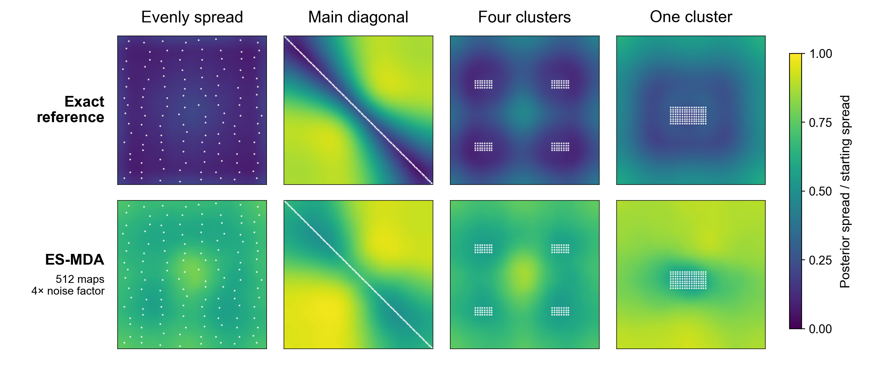
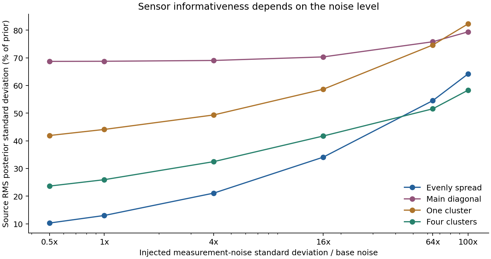

# 2 · How does sensor placement affect posterior uncertainty?

[← Overview](../README.md) · [Evidence](evidence.md) · [Reproduce](reproduction.md#2-sensor-placement)

## Motivation

With the same number of readings, a different sensor layout can leave very different source fields unresolved. In Poisson inversion, a reading observes the potential, which is a spatially smoothed response to the source. Where should those readings be taken, and does a finite ES-MDA ensemble represent the uncertainty that remains?

## Final setup

The study uses a 128×128 Poisson problem, zero boundary potential, 128 sensors per layout, and a fixed Gaussian source prior with smoothness α=2.25 and correlation parameter τ=3.0. Four layouts are compared: evenly spread, main diagonal, one cluster, and four clusters. Coordinates are saved for three placements; the original paired source study uses 48 hidden sources across these placements.

The fixed Gaussian prior and linear observation operator make exact conditioning possible. If H maps source coefficients to sensor readings, then

$$C_{\rm post}=C-C H^T(HCH^T+R)^{-1}HC.$$

This covariance depends on sensor placement and measurement noise, not on the particular observed values. Thus the exact source-spread curves can be regenerated without replaying all 48 observed fields.

**There are two distinct noise quantities:**

| Comparison | Noise being varied |
|---|---|
| ES-MDA map comparison | The solver **assumes** a standard deviation of **4× the initial predicted sensor spread**, with 512 starting members and one update. |
| Exact noise sweep | The **injected measurement-noise** standard deviation is 0.5×, 1×, 4×, 16×, 64×, or **100×** the base value 0.000133. Exact conditioning uses this actual noise. |

The reference row of the map comparison uses the actual base noise. It is not a posterior computed with four times that noise.

## Results: what the maps reveal

White dots show sensors. Each pixel shows posterior standard deviation divided by prior standard deviation. The exact row uses the analytic Gaussian prior; the ES-MDA row compares the same 512 members before and after the update, using their empirical starting spread.

Evenly spread sensors constrain the source most strongly at the base noise. A diagonal layout leaves prominent uncertainty because the domain and forward operator are symmetric under transposition. An antisymmetric source component has zero potential on the diagonal, so readings there cannot resolve that component. Clusters leave gaps in spatial coverage. ES-MDA at the stated assumed noise retains more spread than the exact reference.

## Results: the ordering changes as noise increases

Spread is the RMS pixelwise posterior standard deviation divided by the corresponding prior RMS standard deviation. Values are averaged over the three saved placements.

- Even spacing leaves the least uncertainty at the tested noise levels through 16×.
- Four clusters leave the least at 64× and 100×.
- The main-diagonal layout retains unresolved source structure throughout the sweep.

## Intuitive interpretation

At low noise, broad coverage supplies many spatially distinct constraints. As readings become noisier, that advantage can change: a different allocation of measurements can constrain the dominant uncertain directions more effectively. Under this fixed prior, “spread sensors evenly” is therefore conditional on the noise regime.

The exact comparison measures **sensor informativeness**. The ES-MDA comparison measures how the specified finite-ensemble update represents remaining uncertainty. Those are related questions, but they should not be conflated with a raw cross-layout ranking of posterior discrepancy scores.

## Reproduction and scope

[`presentation_analysis.py`](../experiments/02_sensor_placement/presentation_analysis.py) explicitly implements the final 4×/512-member setting and sweep through 100×. The original 4× presentation image is preserved above. Its ad hoc figure-export script was not saved; the packaged runner supplies a fresh, fully specified stochastic replay, so individual map pixels need not be bit-identical. Its [retained-spread table](../results/02_sensor_placement/final/esmda_retained_spread.csv) records the new replay. The exact covariance sweep is deterministic for the saved coordinates and is recorded in [`final/exact_noise_sweep.csv`](../results/02_sensor_placement/final/exact_noise_sweep.csv).

These are controlled fixed-prior experiments. They do not establish an optimal placement for all Poisson priors or for arbitrary inverse problems. The 4× solver setting is the final ablation setting; it is not the benchmark's published Poisson noise multiplier.
