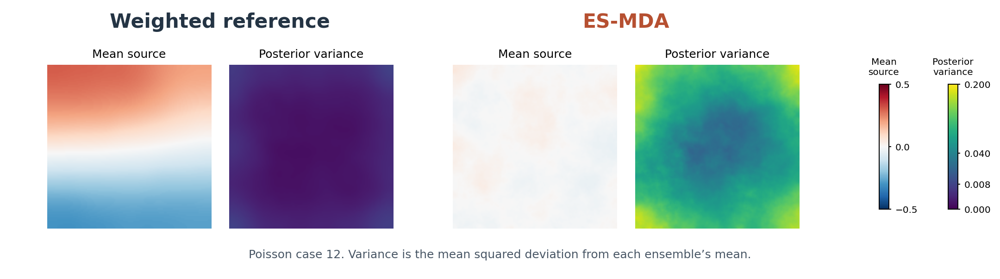
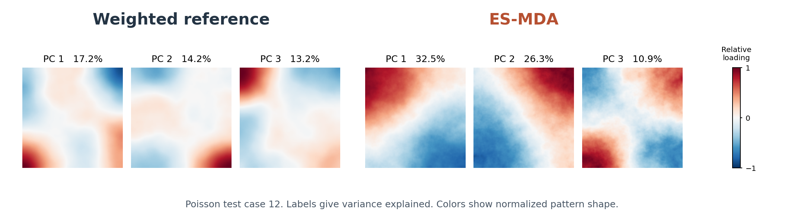
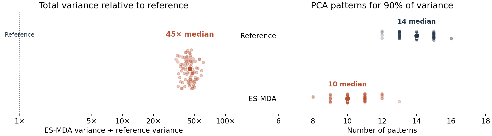

# 3 · How does ES-MDA distribute posterior uncertainty?

[← Overview](../README.md) · [Evidence](evidence.md) · [Reproduce](reproduction.md#3-poisson-posterior-geometry)

## Motivation

Two ensembles can differ in both the amount of uncertainty and the patterns carrying it. A posterior may have large variance concentrated along a few directions. Looking only at spread or only at PCA dimension misses part of that distinction.

## Setup

Use all 90 released Poisson test cases. For each case, compare 100 unfiltered ES-MDA source maps with 100 reference maps, retaining the supplied reference weights. ES-MDA uses the released adapter, 512 prior members, one update, and the published 100× prior-predictive observation-noise profile. This solver profile belongs to this benchmark rerun; experiment 2's final controlled comparison instead uses 4×.

The prior pool is one verified training shard containing **3,572 of the released 50,000 fields**. This restriction is part of the run definition. Scores are close to, but are not an exact reproduction of, the paper's Table 2.

Compute a separate weighted PCA for each ensemble. Report total variance, the number of modes explaining 90% of variance, and the participation ratio

$$d_{\rm PR}=\frac{(\sum_i\lambda_i)^2}{\sum_i\lambda_i^2}.$$

## First inspect the means and variances

In case 12, the reference mean has a positive region toward the top and a negative region toward the bottom. The ES-MDA mean is flatter and close to zero. Its much larger pixelwise variance is visible before any PCA decomposition.

## Then inspect the leading patterns

These are separate PCAs, not matched components. Component signs are arbitrary and each displayed loading is normalised to show shape. In case 12, the first three modes explain approximately 69.8% of ES-MDA variance and 44.7% of reference variance.

## Results across cases

| Statistic | Weighted reference | ES-MDA |
|---|---:|---:|
| Median modes for 90% variance | 14 | 10 |
| Median participation ratio | 10.20 | 5.27 |
| Median paired total-variance ratio | 1× | 45.02× |

The variance ratio is computed **within each case before taking the median**. It is not the ratio of two independently computed medians. ES-MDA has greater variance and a lower participation ratio in every one of the 90 cases. A 38-map subsampling check gives the same qualitative result: median paired variance ratio 44.84×.

## Intuitive interpretation

Imagine an uncertainty cloud that becomes much larger while elongating strongly along a few axes. It has more spread and fewer dominant linear patterns at the same time. That is the combination observed here. Fewer PCA modes should therefore not be read as a better or sharper posterior.

The mean and spatial loading maps help explain what a scalar variance discrepancy leaves unspecified: where the uncertainty is and which source patterns dominate it.

## Limits

- PCA describes linear covariance geometry, not the full nonlinear support of a distribution.
- The attempted finite-scale nonlinear dimension comparison was unresolved: no case had a supported estimate for both ensembles at 100 maps. No nonlinear-dimension conclusion is claimed.
- Finite weighted reference ensembles are estimates, and their effective sample sizes vary.
- Conclusions concern this ES-MDA profile and available training shard. They are not a statement about every ES-MDA configuration or all inverse solvers.

Evidence: [`per_case_100.csv`](../results/03_posterior_geometry/dimensions/per_case_100.csv), [`summary.csv`](../results/03_posterior_geometry/dimensions/summary.csv), and [`paired_ratios.csv`](../results/03_posterior_geometry/dimensions/paired_ratios.csv). The older pilot's 6.75×/29-mode result is not the run reported here.
