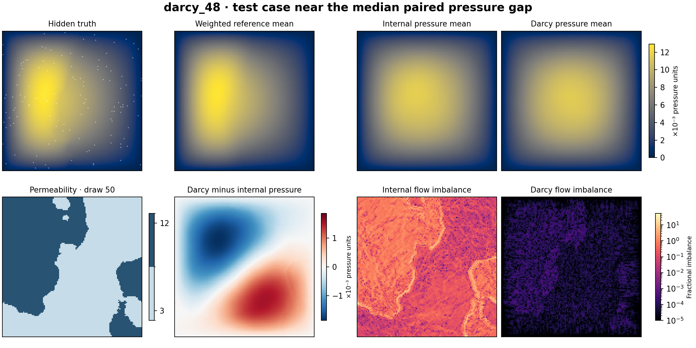
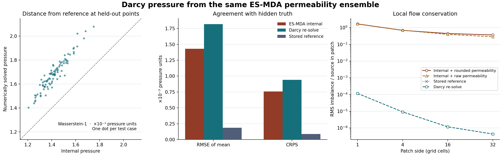

# 4 · Does ES-MDA's pressure satisfy Darcy's equation?

[← Overview](../README.md) · [Evidence](evidence.md) · [Reproduce](reproduction.md#4-darcy-consistency)

## Motivation

ES-MDA updates a joint permeability–pressure ensemble. The pressure channel can fit observations without necessarily being the forward solution of its updated permeability channel. How large is that inconsistency, and what happens when it is repaired?

## Paired experiment

Run the released Darcy ES-MDA profile on all 90 test cases: 128 starting members drawn from the full 50,000-pair prior pool, two updates with inflation [2,2], observation-error multiplier 10, and 100 retained draws per case.

Save three aligned arrays for every case: rounded permeability `a`, pre-rounding permeability `a_raw`, and internal pressure `u`. For **each of the 9,000 rounded permeability maps**, independently solve

$$-\nabla\cdot(a\nabla u)=1,\qquad u|_{\partial\Omega}=0.$$

This creates a paired comparison: permeability and member index stay fixed, while internal pressure is replaced by a pressure satisfying the released discrete forward equations. Compare both pressure ensembles with the weighted reference and the stored hidden true pressure.

## Predictive fit worsens after re-solving

Held-out locations are the 16,256 grid points outside the 128 inference sensors. Values below are case averages in units of 10⁻³ pressure.

| Metric | Internal pressure | Darcy re-solve | Weighted reference |
|---|---:|---:|---:|
| Pointwise W1 to reference | 1.422 | 1.686 | — |
| RMSE of mean to hidden truth | 1.431 | 1.820 | 0.186 |
| CRPS against hidden truth | 0.758 | 0.940 | 0.089 |

Held-out mean RMSE increases by about 27%, reference W1 by about 19%, and CRPS by about 24%. All three worsen in all 90 cases. These percentages compare case-averaged values. Whole-case bootstrap intervals for the mean paired changes are included in the saved summary.

## Local conservation improves dramatically

For each interior square, compute net outward face flux minus its enclosed source, divided by patch area. For a 16×16-cell patch, RMS fractional imbalance falls from **0.44545 (44.5%)** to **1.17×10⁻⁶ (0.000117%)**, at the precision floor of the stored reference.

## Why the numerical control matters

The solver uses the released interpolation, coefficient clipping to [3,12], face averaging, forcing, and boundary conditions. Re-solving all 90 hidden truths and 268 sampled reference members reproduces their stored pressure with worst RMSE below 2×10⁻¹⁰. Input-permeability hashes verify the pairing of saved numerical pressures.

The raw-permeability control also has substantial imbalance: approximately 39.4% for the 16×16 patch. The observed inconsistency is therefore not accounted for solely by the final binary projection.

## Intuitive interpretation

The internal pressure can benefit from a joint-state update even when the permeability–pressure pair no longer lies on the forward-model relationship. Re-solving forces it back onto that relationship and reveals the predictive consequences of the inferred permeability.

Physical consistency and predictive fit are two distinct diagnostics. This experiment observes a trade-off under the released setup; it does not establish that enforcing physics necessarily worsens inverse solutions in general, nor that re-solving recovers the correct posterior over permeability.

Evidence: [`pressure_by_case.csv`](../results/04_darcy_consistency/pressure_by_case.csv), [`conservation_by_case.csv`](../results/04_darcy_consistency/conservation_by_case.csv), [`solver_controls_by_case.csv`](../results/04_darcy_consistency/solver_controls_by_case.csv), and [`summary.json`](../results/04_darcy_consistency/summary.json).
