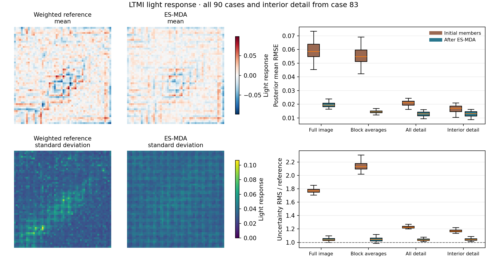
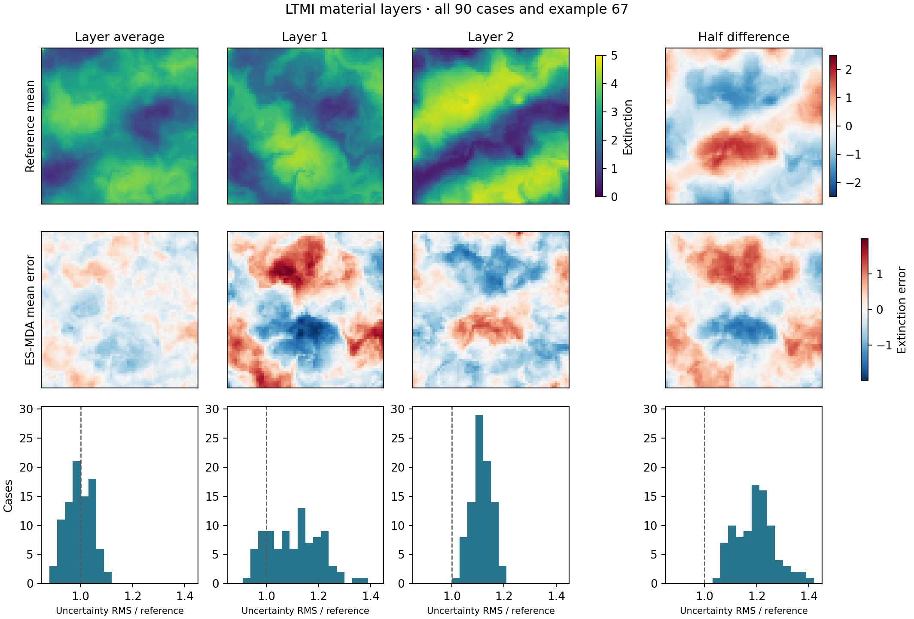

# 5 · What does ES-MDA recover on LTMI?

[← Overview](../README.md) · [Evidence](evidence.md) · [Reproduce](reproduction.md#5-ltmi-recovery)

## Motivation

Layered transport material inversion (LTMI) infers two material layers from a lower-resolution light observation. Two questions follow: does the inferred light distribution improve in details that are absent from the readings, and what does evaluation of the **average of the layers** conceal?

## Setup

Use all 90 released test cases and the complete pool of 100,000 prior samples. The released ES-MDA profile uses 1,024 starting members, one update, and observation noise equal to initial predicted sensor spread. Retain 100 aligned material-layer and internal-light maps per case. Reference comparisons preserve the supplied weights.

The light response has resolution 64×64; the observation averages each 4×4 block to obtain 16×16 readings. The official evaluator scores `(layer_1 + layer_2)/2`.

## A · Light detail beyond the observed resolution

Subtract each 4×4 block's mean from its pixels. The resulting residual has zero block average, so it is invisible to the observation operator. Compare these fine details before and after assimilation using the **same members**, against the weighted reference response ensemble.

| Light component | Prior mean-map RMSE | ES-MDA mean-map RMSE |
|---|---:|---:|
| Observed-resolution block averages | 0.0551 | 0.0145 |
| Within-block detail | 0.0209 | 0.0131 |
| Within-block detail excluding the outer 4-pixel band | 0.0167 | 0.0130 |

Mean fine-detail RMSE drops by about 37%, or 22% for interior detail. Fine-detail MMD improves in all 90 cases. Overall detail spread becomes close to the reference, but the standard-deviation map still has a 23.7% relative error: the amount and location of uncertainty are distinct.

**Interpretation:** learning from coarse observations can improve unobserved detail through the prior's cross-scale correlations. These maps are the internal ES-MDA light response. An independent renderer is needed to establish whether each inferred material pair actually produces its paired light map.

## B · What the layer average hides

Define the average and half-difference as

$$A=(L_1+L_2)/2,\qquad D=(L_1-L_2)/2.$$

If the layer errors are e₁ and e₂, then pointwise

$$\frac{e_1^2+e_2^2}{2}=\left(\frac{e_1+e_2}{2}\right)^2+\left(\frac{e_1-e_2}{2}\right)^2.$$

An overestimate in one layer can cancel an underestimate in the other in A, while remaining visible in D.

| Material quantity | Case-averaged relative mean-map error |
|---|---:|
| Layer average | 12.5% |
| Layer 1 | 30.6% |
| Layer 2 | 21.7% |
| Half-difference | 73.0% |

The half-difference term accounts for **79.64% of the combined squared posterior-mean error**, pooled across cases and pixels. This fraction is computed in absolute squared-error units; it is not derived by squaring the differently normalised percentages above.

The same cancellation affects uncertainty. Average within-pixel cross-layer correlation is −0.28 for ES-MDA versus −0.10 for the reference. About 5.4% and 5.3% of raw layer pixel values are negative, versus 1.1% after averaging and none in the references; negative extinction is physically invalid in the passive-medium interpretation.

## Limits

Reference effective sample size has median 11.5. Restricting to the 45 highest-ESS cases retains the qualitative findings, with approximately 40% fine-detail mean-RMSE improvement and 81.6% hidden mean-error fraction. These checks reduce, but do not eliminate, uncertainty from a finite weighted reference. The findings concern this solver and release; they do not imply that the scored average is useless or that internal light maps are independently rendered physical solutions.

Evidence: [`per_case.csv`](../results/05_ltmi_recovery/posterior_analysis/per_case.csv), [`summary.json`](../results/05_ltmi_recovery/posterior_analysis/summary.json), and the [released-evaluator output](../results/05_ltmi_recovery/official_evaluation.json).
